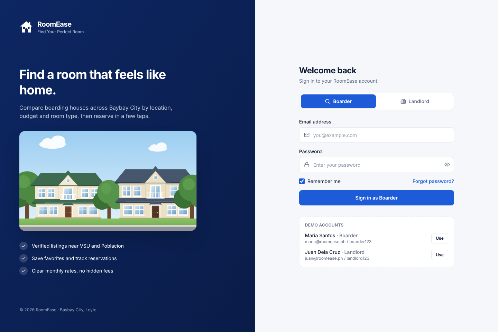

# RoomEase

Find and manage boarding houses in Baybay City. Frontend prototype with a login page and separate dashboards for **boarders** and **landlords**.

| Login | Boarder | Landlord |
| --- | --- | --- |
|  |  |  |

## Run it

```bash
npm install
npm run dev
```

Open http://localhost:5173 and sign in with a demo account (or click **Use** on the login page):

| Role | Email | Password |
| --- | --- | --- |
| Boarder | `maria@roomease.ph` | `boarder123` |
| Landlord | `juan@roomease.ph` | `landlord123` |

Other scripts: `npm run build` (production build to `dist/`), `npm run preview`, `npm run lint`.

## Project structure

```
src/
  App.jsx                    routes + role protection
  index.css                  Tailwind theme and per-role colors
  config/navigation.js       sidebar items and role labels
  context/AuthContext.jsx    mock sign-in / sign-out (localStorage or sessionStorage)
  context/DataContext.jsx    favorites and reservations shared by layout and dashboards
  data/mockData.js           demo users, listings, locations, reservations
  components/
    layout/                  sidebar, top bar, dashboard shell
    ui/                      cards, badges, modal, logo
    illustrations/           SVG house, room and street scenes
  pages/
    Login.jsx
    boarder/BoarderDashboard.jsx
    landlord/LandlordDashboard.jsx
    ComingSoon.jsx           placeholder for pages not built yet
```

## Notes

- **No backend yet.** Sign-in checks the demo accounts in `src/data/mockData.js`; replace `login()` in `AuthContext.jsx` with an API call when the backend is ready.
- **Real photos:** put images in `public/images/` and set `photo: '/images/your-file.jpg'` on a listing in `mockData.js`. Without a photo, an illustration is shown.
- **Deploying:** this is a single-page app using browser routing, so the host must serve `index.html` for unknown paths (e.g. a rewrite rule on Vercel or Netlify).

See [PLAN.md](PLAN.md) for the build plan and next phases.
