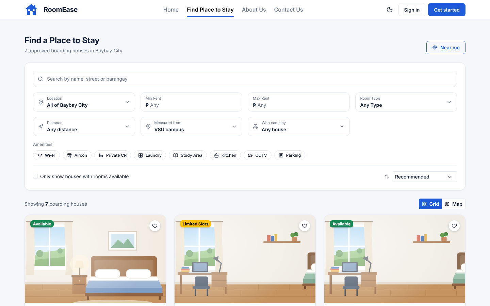
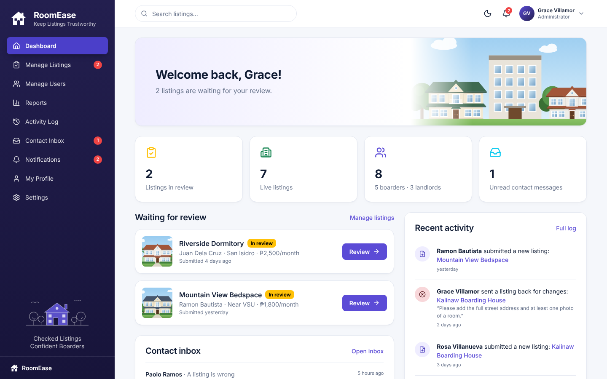
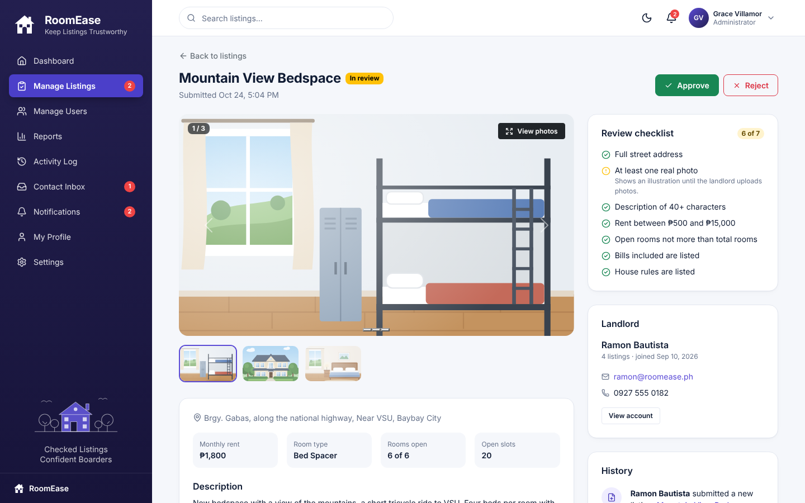

# RoomEase

Find and manage boarding houses in Baybay City. Frontend prototype built with **React + Bootstrap 5**: a public site where anyone can **Find a Place to Stay** without an account, sign-in/sign-up with password reset, and full dashboards for **boarders** (browse, near me, map, compare, reserve, review, chat), **landlords** (listings with house rules and bills, availability, requests, analytics, chat) and **admins** (listing review, users, reports, activity log, contact inbox). Includes light and dark mode.

It follows the PHP version of RoomEase ([Hanzoo123/Roomease](https://github.com/Hanzoo123/Roomease)): same room types, the same public menu (Home · Find Place to Stay · About Us · Contact Us), the same listing review states and the same password rules.

| Landing page | Find Place to Stay (no account needed) | Boarder dashboard |
| --- | --- | --- |
|  |  |  |
| **Browse on the map** | **Landlord dashboard** | **Analytics** |
|  |  |  |
| **Admin dashboard** | **Admin listing review** | **Dark mode** |
|  |  |  |

## Run it

```bash
npm install
npm run dev
```

Open http://localhost:5173. Sign in with a demo account (or click **Use** on the login page):

| Role | Email | Password |
| --- | --- | --- |
| Boarder | `maria@roomease.ph` | `boarder123` |
| Landlord | `juan@roomease.ph` | `landlord123` |
| Admin | `admin@roomease.ph` | `admin123` |

More landlords for testing: `rosa@roomease.ph` and `ramon@roomease.ph` (password `landlord123`). Rosa has a listing that was sent back for changes; Ramon has one waiting for review.

Other scripts: `npm run build` (production build to `dist/`), `npm run preview`, `npm run lint`.

## Features

**Everyone (no account needed)**
- Public site with the PHP version's menu: **Home · Find Place to Stay · About Us · Contact Us**, plus Privacy Policy and Terms & Conditions
- **Find Place to Stay**: the full browse page, room pages, map and compare, open to guests. Saving, reserving, reviewing or messaging asks them to sign in, then brings them back to the same room
- Landing page with search, "lowest rent with a free slot", **room type tiles** (Single Room, Private Room, Double Sharing, Bed Spacer, Dormitory), top-rated rooms, areas, FAQ
- **Contact form** that goes to the admin's inbox (with a bot trap and a limit of 3 messages an hour per email)
- **Forgot password** with a 6-digit code (valid 10 minutes, 5 tries); the demo shows the code on screen because there is no email service
- Password checklist on sign-up, settings and reset (8+ characters, upper and lower case, a number, a symbol), and Philippine mobile number checks
- Light / dark mode, remembered per browser; toasts, page fade-ins and loading placeholders

**Boarders**
- Browse with filters (area, rent, room type, amenities, availability, **who can stay**) and sorting, in a **grid or on a map** with price pins
- **Near me**: uses the browser's location (kept on the device) to sort by distance, with a **within 500 m / 1 / 2 / 5 km** filter measured from VSU, the town center or you
- Room details with a **photo carousel**, **Living here** (curfew, minimum stay, visitors, cooking, pets, payment), **What's included** (bills), **House rules**, **Worth asking the landlord** (one tap sends the question as a message), **Copy number**, **Copy link**, and a location map with **Show my location** and **Get directions**
- See the landlord's reason when a request is declined
- **Ratings & reviews**: only boarders with an approved stay can review; edit or delete your own
- **Compare** up to 3 rooms side by side, with the best value in each row highlighted
- **Messages** with landlords, reservation requests, favorites, recently viewed, notifications

**Landlords**
- Dashboard with stats and **charts** (requests per month, request status); full **Analytics** page with occupancy, approval rate, average rating, views per property and a performance table (each chart has a table view)
- Add/edit listings with **up to 5 photos**, a **map pin**, **stay terms**, **house rules** and **bills included**; room availability steppers
- Listing states as the admin sets them: **In review → Live**, or **Needs changes** with the admin's reason. Editing a sent-back listing resubmits it
- Approve/decline reservation requests (with an optional reason the boarder sees), **reply to reviews**, and **message boarders**

**Admins**
- Dashboard with the review queue (oldest first), site stats, unread contact messages and recent activity
- **Manage Listings**: In review / Live / Needs changes / Removed tabs, approve, **reject with a reason**, **remove** (hidden, not deleted) and restore. Each listing has a review page with a checklist (address, photos, rent range, bills, rules), the landlord's details and its history
- **Manage Users**: search, filter by role, view details, **deactivate** (with a reason) and reactivate accounts; deactivated accounts can't sign in
- **Reports**: KPIs, requests per month, request status, new accounts, listings by room type and area, average rent by area, and **CSV export** of listings, accounts and reservations (cells are guarded against spreadsheet formulas)
- **Activity Log** of approvals, rejections, removals, account changes and reservation decisions, with filters and CSV export
- **Contact Inbox** for messages from the Contact Us page: read/unread, reply by email, delete

## Try these demos

- **Guest to boarder:** signed out, open **Find Place to Stay**, try **Near me**, open a room and tap a question under *Worth asking the landlord*. Sign in as Maria and you land back on that room; tap it again and the question is waiting in Messages.
- **Listing review:** sign in as Ramon and look at *Mountain View Bedspace* (In review). Sign in as the admin, open **Manage Listings**, and approve or reject it with a reason. Back as Ramon, the listing shows the result. Rosa's *Kalinaw Boarding House* shows the resubmit flow.
- **Reservation flow:** as Maria, open a room and send a reservation request. Log out, sign in as Juan, approve or decline it (with a reason) under **Reservation Requests**, then sign back in as Maria to see the result.
- **Forgot password:** on the sign-in page, tap *Forgot password?*, enter `maria@roomease.ph`, and use the code shown in the demo inbox.
- **Review:** as Maria, open **Green Haven Residences** (she has a past stay there) and rate it.
- **Live chat in two tabs:** in tab 1 sign in as Maria with **Remember me unchecked**; in tab 2 sign in as Juan the same way. Messages sent in one tab appear in the other right away.
- **Compare:** tap the scale icon on 2–3 room cards, then **Compare** in the tray at the bottom.

## Project structure

```
src/
  App.jsx                    routes (each page lazy-loaded): public site, auth, and role-protected dashboards
  index.css                  Bootstrap theme overrides, per-role colors, dark mode, app styles
  config/navigation.js       sidebar items and role labels
  context/
    AuthContext.jsx          mock accounts: sign in, sign up, profile, password, reset codes, deactivation
    DataContext.jsx          stand-in backend: listings, moderation, reservations, reviews, messages, activity log, contact inbox
    SitePaths.jsx            room links for the public site vs. the boarder dashboard; guest sign-in prompts
    ThemeContext.jsx         light / dark mode
    ToastContext.jsx         confirmation pop-ups
  data/mockData.js           seed data (dates are relative to today), room types, geo helpers
  data/validation.js         email, phone and password rules (same as the PHP version)
  data/storage.js            safe localStorage helpers
  data/images.js             in-browser photo resizing
  components/
    admin/                   moderation actions, reason dialog, activity log rows, CSV export
    auth/                    shared sign-in / sign-up layout, password checklist
    charts/                  Chart.js charts and the numbers behind them
    illustrations/           SVG house, room and street scenes
    layout/                  sidebar, top bar, dashboard shell, public site layout
    listings/                room card, listing row, listing status, stay terms, filters, photo gallery, compare
    map/                     Leaflet map, the Browse map view, and the "near me" location hook
    reservations/            reservations table and review dialog
    reviews/                 stars, rating badge, reviews section
    ui/                      cards, badges, tabs, modal, form fields, skeletons, logo, avatar, copy button
  pages/
    Landing.jsx, Login.jsx, Signup.jsx, ForgotPassword.jsx, NotFound.jsx
    public/                  About, Contact, Privacy Policy, Terms & Conditions
    admin/                   dashboard, manage listings, listing review, users, reports, activity log, inbox
    boarder/                 dashboard, browse, room details, compare, reservations, favorites
    landlord/                dashboard, listings, listing form/view, availability, requests, analytics
    shared/                  messages, notifications, profile, settings
```

## Notes

- **No backend yet.** Accounts and app data are saved in the browser's localStorage (passwords included, in plain text — demo only). Replace the functions in `AuthContext.jsx` and `DataContext.jsx` with API calls when the backend is ready. No email is sent: reset codes appear on screen, and contact messages go only to the admin inbox in the same browser.
- **Not carried over from the PHP version yet** (they need a server): Google sign-in, real email (reset codes, notifications), and several rooms with their own rent inside one boarding house.
- **Start over:** Settings → *Reset demo data* restores the original listings, reservations, reviews and messages.
- **Maps** use free OpenStreetMap tiles, so they need an internet connection. Pin locations are approximate. If tiles can't load, the pins still show.
- **Photos:** landlords can upload up to 5 photos per listing (resized in the browser). Browser storage holds roughly 5 MB, so many large listings can fill it; the app warns you if a save fails. Without photos, illustrations are shown.
- **Deploying:** this is a single-page app using browser routing, so the host must serve `index.html` for unknown paths (e.g. a rewrite rule on Vercel or Netlify).

See [PLAN.md](PLAN.md) for the build plan and next phases.
