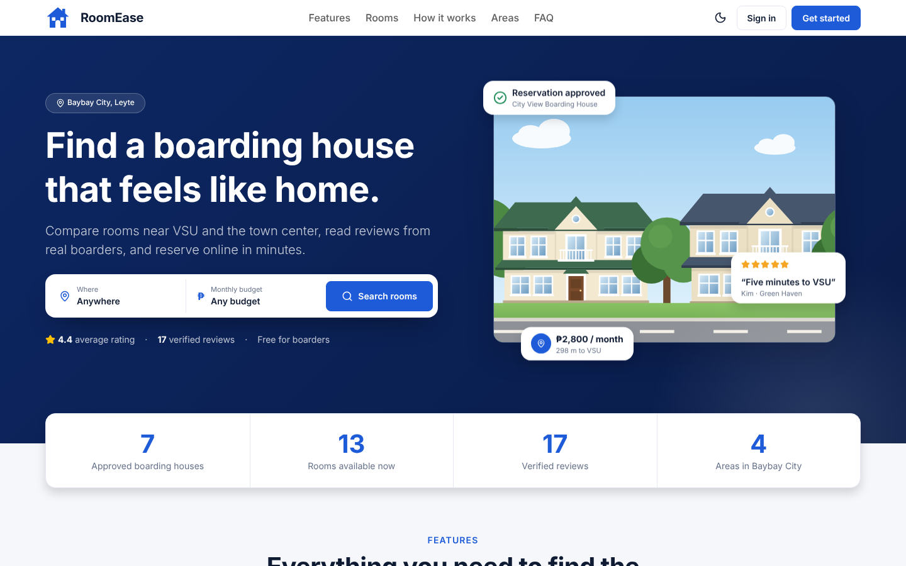
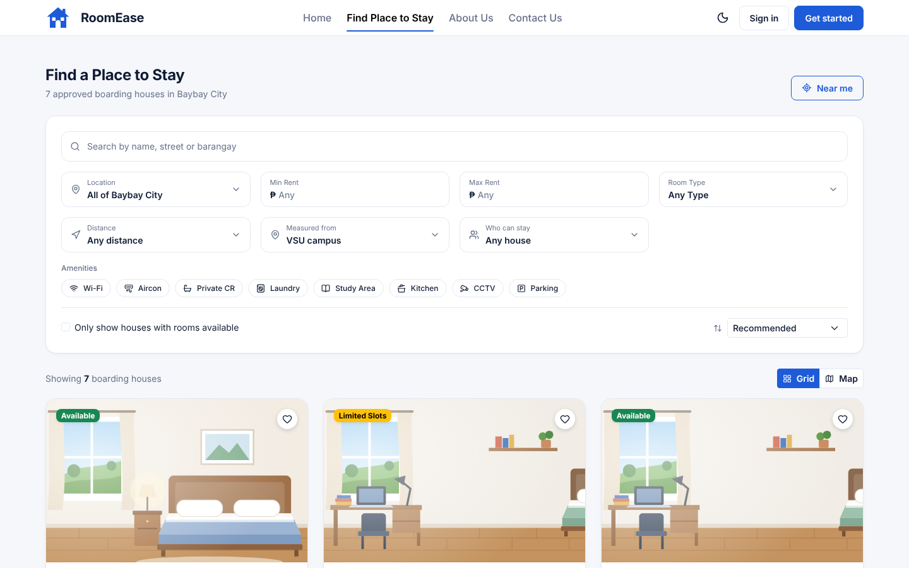
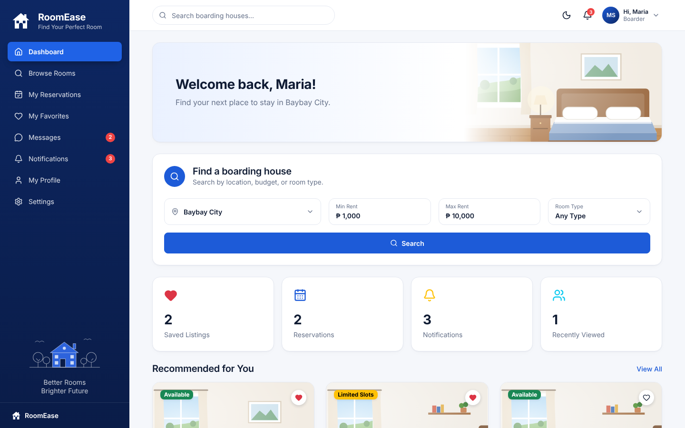
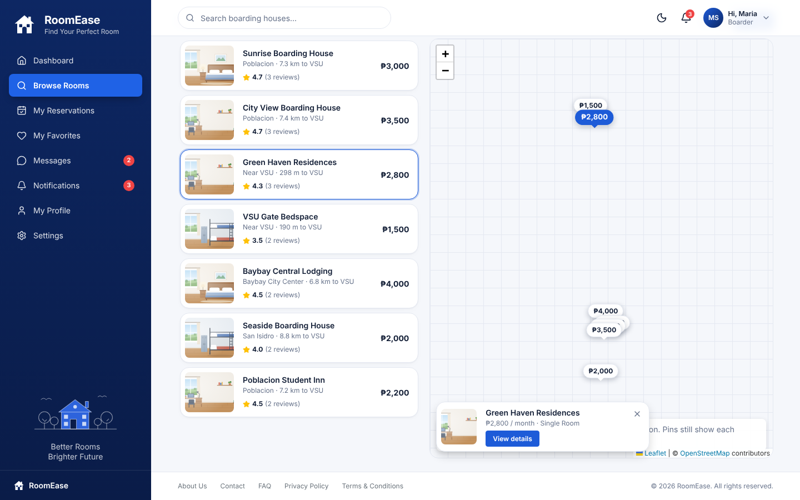
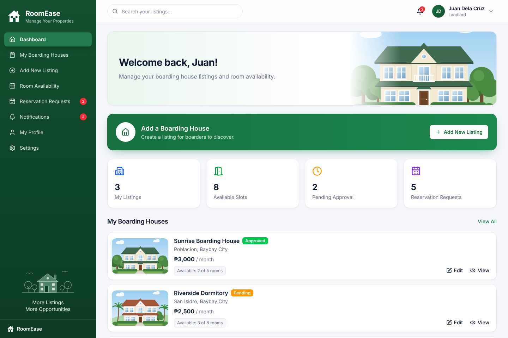
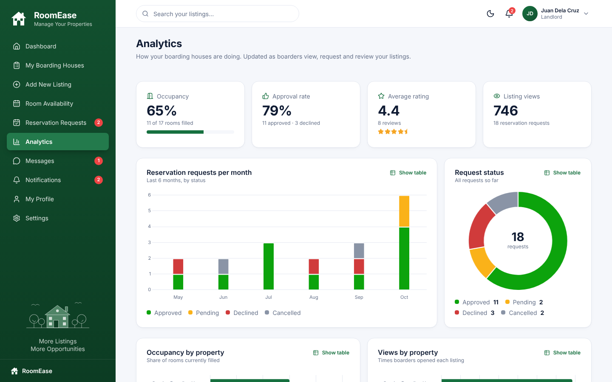
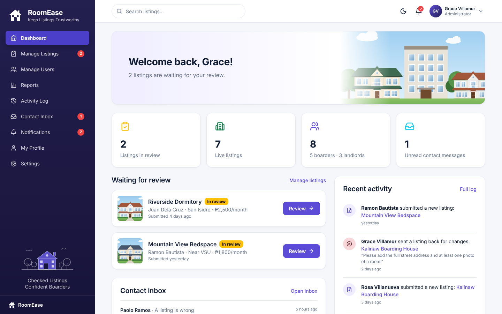
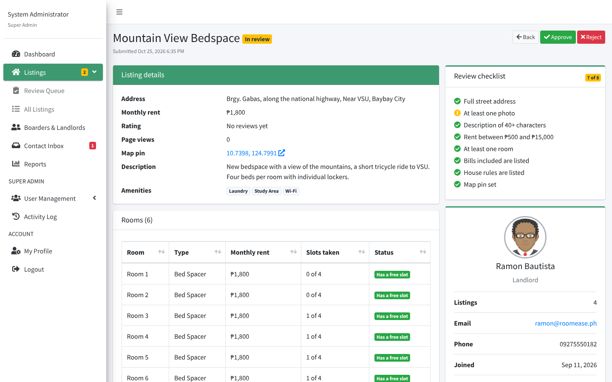
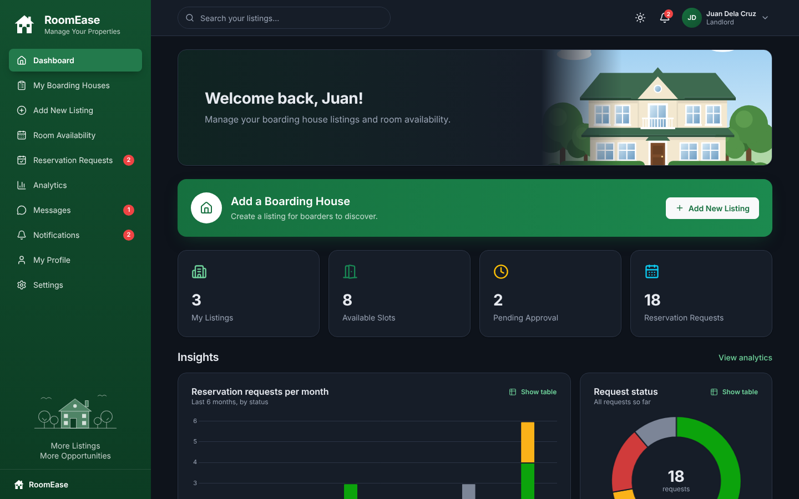

# RoomEase

Find and manage boarding houses in Baybay City. Two parts:

- **The website** (React + Bootstrap 5): a public site where anyone can **Find a Place to Stay** without an account, sign-in and sign-up with password reset, and full dashboards for **boarders** and **landlords**. Boarders can browse, use "near me", the map and compare, reserve, review and chat. Landlords manage listings with house rules and bills, availability, requests and analytics, and can chat too. Light and dark mode.
- **The admin panel** (AdminLTE 3 + PHP + MySQL, for WAMP64) for **admins** and **super admins**: listing review, boarders and landlords, reports with exports, contact inbox, and for super admins, admin accounts and the activity log.
- **The API** (PHP + MySQL, `backend/api/`) that the website uses. So far it handles:
  - accounts: sign-up, sign-in, "Remember me", profile and photo, password change and reset;
  - the public listings on Find Place to Stay and the room pages, including each room's own rent and free slots;
  - landlords' own listings: adding one (with its rooms and photos) sends it to the admin panel's review queue, the admin's reason shows when it is sent back, and saving it resubmits it;
  - reservations: a boarder requests a particular room, the landlord approves (taking a bed) or declines with a reason, and each sees the other's answer in their own browser;
  - saved listings, reviews (after an approved stay) and landlord replies;
  - messages between boarders and landlords (an open chat shows a reply within a few seconds), notifications, and the Contact Us form, which lands in the admin panel's inbox.

  Password reset codes go out by email through Gmail (see [Email](#email-for-password-reset-codes-gmail) below), and [Going live](#going-live) lists the steps (and tools) for production: errors hidden, your own super admin, the demo data removed, daily backups.

It follows the PHP version of RoomEase ([Hanzoo123/Roomease](https://github.com/Hanzoo123/Roomease)): same room types, the same public menu (Home · Find Place to Stay · About Us · Contact Us), the same listing review states and the same password rules.

| Landing page | Find Place to Stay (no account needed) | Boarder dashboard |
| --- | --- | --- |
|  |  |  |
| **Browse on the map** | **Landlord dashboard** | **Analytics** |
|  |  |  |
| **Admin panel (AdminLTE)** | **AdminLTE listing review** | **Dark mode** |
|  |  |  |

## Run it

### On WAMP64 (no Node.js needed)

1. Put the project folder in `C:\wamp64\www` (e.g. `C:\wamp64\www\RoomeaseV2`, or `RoomeaseV2-main` from the ZIP download) and start WAMP.
2. Import the database once. In phpMyAdmin (http://localhost/phpmyadmin, user `root`, no password), click **Import**, choose `database/roomease.sql`, and click **Go**. Both the website's sign-in and the admin panel use it.
3. Open the website at **http://localhost/RoomeaseV2/** (use your folder's name). The built site is already in `dist/`, and `index.php` with `.htaccess` serve it from whatever folder it's in.

Website demo accounts (stored in MySQL; click **Use** on the sign-in page):

| Role | Email | Password |
| --- | --- | --- |
| Boarder | `maria@roomease.ph` | `Boarder#2026` |
| Landlord | `juan@roomease.ph` | `Landlord#2026` |

More landlords for testing: `rosa@roomease.ph` and `ramon@roomease.ph` (password `Landlord#2026`). Rosa has a listing that was sent back for changes; Ramon has one waiting for review.

If you change anything in `src/`, run `npm run build` to update `dist/`; WAMP then shows the new version.

### Email for password reset codes (Gmail)

"Forgot password" emails a 6-digit code. Until email is set up, the code is shown on the screen instead, but only to someone browsing on the WAMP computer itself.

1. In your Google Account, turn on 2-Step Verification, then create an **App Password** (Security → 2-Step Verification → App passwords). It's 16 letters; your normal Gmail password won't work.
2. In the project folder, copy `.env.example` to `.env` and set:

   ```
   ROOMEASE_MAIL_USERNAME=you@gmail.com
   ROOMEASE_MAIL_PASSWORD="abcd efgh ijkl mnop"
   ROOMEASE_MAIL_PORT=587
   ```

   These are the same names as in the first RoomEase project's `.env`, so those lines can be copied as they are. Port 465 (the default) also works. `.env` is ignored by git and the web server refuses to serve it, so the App Password stays on your computer.
3. Check it from a Command Prompt in the project folder, with WAMP's PHP (your version number may differ):

   ```
   C:\wamp64\bin\php\php8.2.13\php.exe backend\tools\send-test-email.php you@example.com
   ```

   It says **Sent**, or what to fix (a wrong App Password, a blocked port, or PHP not trusting Gmail's certificate, which `ROOMEASE_MAIL_CA_BUNDLE` solves). Then try "Forgot password" on the sign-in page.
4. Before anyone else can reach the site (including through ngrok), add `ROOMEASE_SHOW_RESET_CODES=false` to `.env`.

Each email is logged in `backend/logs/mail.log` (who, when, and whether it worked; never the code or the password). The database settings can go in `.env` too (`ROOMEASE_DB_HOST`, `_NAME`, `_USER`, `_PASS`; see `.env.example`).

### Going live

Before other people use RoomEase (on your network, through ngrok, or on a host), run these from a Command Prompt in the project folder. `php` below means WAMP's PHP, e.g. `C:\wamp64\bin\php\php8.2.13\php.exe`.

1. **See what's left:** `php backend/tools/go-live-check.php` lists what to fix and how. Run it again after each step; it ends with **Ready to go live**.
2. **Production mode:** add `ROOMEASE_ENV=production` to `.env`. PHP errors are then never shown on a page (they're logged to `backend/logs/php-errors.log`), and reset codes are never shown on screen.
3. **Email:** set up Gmail (above) and test it.
4. **Your own super admin:** `php backend/tools/create-super-admin.php` asks for a username, email and name, and prints a one-time password. Sign in to the admin panel with it; it asks you to choose your own password straight away.
5. **Remove the demo data:** `php backend/tools/remove-demo-data.php` shows what it would remove: the demo accounts (their passwords are in this README), with their listings, reservations, reviews, messages and notifications, and the sample Contact Us messages. Add `--yes` to remove it. It makes a backup first, keeps every account that isn't a demo one, and won't run until step 4 is done.
6. **Back up every day:** `php backend/tools/backup-database.php` saves the database, and the uploaded photos as a zip, in `backend/backups/` (the newest 30 are kept). To make it daily, open Task Scheduler → Create Basic Task → Daily → Start a program: WAMP's `php.exe`, with the argument `backend\tools\backup-database.php` and "Start in" set to the project folder. Copy the backups to a USB drive or a cloud folder now and then.
   - **Restoring:** phpMyAdmin → Import → choose the `.sql` file; then unzip the photos zip into `backend/`.
7. **HTTPS:** if people reach it from other devices, serve it over HTTPS (ngrok gives you an `https://` address). Sign-in cookies then become secure-only by themselves.

`.env`, `backend/tools/`, `backend/logs/` and `backend/backups/` can't be opened from a browser, and the site sends basic security headers and shows no folder listings (`.htaccess`).

### While developing (React with live reload)

```bash
npm install
npm run dev
```

Open http://localhost:5173. Keep WAMP running: the dev server sends the API (`/backend/…`) to WAMP. It expects the project at `http://localhost/RoomeaseV2/`; if your folder is named differently, copy `.env.example` to `.env.local` and set `ROOMEASE_WAMP_URL`.

Without WAMP, set `VITE_USE_API=false` in `.env.local`. Accounts then stay in the browser like the first prototype, and the demo passwords are `boarder123` and `landlord123`.

Other scripts: `npm run build` (updates `dist/`, the version WAMP serves) and `npm run lint`.

### The admin panel (AdminLTE on WAMP64)

1. Clone this repository into `C:\wamp64\www` (so the folder is `C:\wamp64\www\RoomeaseV2`) and start WAMP.
2. In phpMyAdmin (http://localhost/phpmyadmin, user `root`, no password), click **Import**, choose `database/roomease.sql`, and click **Go**.
3. Open http://localhost/RoomeaseV2/backend/admin/ and sign in:

| Role | Username (or email) | Password |
| --- | --- | --- |
| Super Admin | `superadmin` (`superadmin@roomease.ph`) | `Superadmin#2026` |
| Admin | `admin` (`admin@roomease.ph`) | `Admin#2026` |

The website's sign-in page links to the admin panel ("Admin or super admin?"), and `/admin` redirects there. On WAMP it finds the panel by itself; with `npm run dev` it follows `ROOMEASE_WAMP_URL`.

Website accounts and the admin panel share MySQL: someone who signs up on the website appears under **Boarders & Landlords**, and deactivating them there signs them out of the website within a minute. Listings are shared too: a landlord's new listing appears under **Listings > In review**, and approving it, sending it back with a reason or removing it shows on the website. Reservations made on the website appear in the admin panel's reports and on each boarder's page, a Contact Us message appears in the **Contact Inbox**, and the admin panel's decisions on a listing reach the landlord's notifications.

## Features

**Everyone (no account needed)**
- Public site with the PHP version's menu: **Home · Find Place to Stay · About Us · Contact Us**, plus Privacy Policy and Terms & Conditions
- **Find Place to Stay**: the full browse page, room pages, map and compare, open to guests. Saving, reserving, reviewing or messaging asks them to sign in, then brings them back to the same room
- Landing page with search, "lowest rent with a free slot", **room type tiles** (Single Room, Private Room, Double Sharing, Bed Spacer, Dormitory), top-rated rooms, areas, FAQ
- **Contact form** that goes to the admin's inbox (with a bot trap and a limit of 3 messages an hour per email)
- **Forgot password** with a 6-digit code (valid 10 minutes, 5 tries). Until email is set up, the code is shown on screen, but only to the computer running WAMP (`backend/config/app.php`)
- Password checklist on sign-up, settings and reset (8+ characters, upper and lower case, a number, a symbol), and Philippine mobile number checks
- Light / dark mode, remembered per browser; toasts, page fade-ins and loading placeholders

**Boarders**
- Browse with filters (area, rent, room type, amenities, availability, **who can stay**) and sorting, in a **grid or on a map** with price pins
- **Near me**: uses the browser's location (kept on the device) to sort by distance, with a **within 500 m / 1 / 2 / 5 km** filter measured from VSU, the town center or you
- Room details with a **photo carousel**, **Living here** (curfew, minimum stay, visitors, cooking, pets, payment), **What's included** (bills), **House rules**, **Worth asking the landlord** (one tap sends the question as a message), **Copy number**, **Copy link**, and a location map with **Show my location** and **Get directions**
- See the landlord's reason when a request is declined
- **Ratings & reviews**: only boarders with an approved stay can review; edit or delete your own
- **Compare** up to 3 rooms side by side, with the best value in each row highlighted
- **Messages** with landlords, reservation requests, favorites, recently viewed, notifications

**Landlords**
- Dashboard with stats and **charts** (requests per month, request status); full **Analytics** page with occupancy, approval rate, average rating, views per property and a performance table (each chart has a table view)
- Add/edit listings with **several rooms** (each with its own type, rent and beds), **up to 5 photos**, a **map pin**, **stay terms**, **house rules** and **bills included**
- **Room availability** per room: beds taken, and open or closed
- Listing states as the admin sets them: **In review → Live**, or **Needs changes** with the admin's reason. Editing a sent-back listing resubmits it
- Approve/decline reservation requests (with an optional reason the boarder sees), **reply to reviews**, and **message boarders**

**Admins and super admins** (AdminLTE panel, `backend/admin/`)
- Uses the uploaded AdminLTE template as-is: the olive theme, sidebar, cards, DataTables with Copy / CSV / Excel / PDF / Print, and toastr messages
- **Dashboard**: listings waiting for review (oldest first), site totals, new contact messages; super admins also see recent activity
- **Listings**: In review / Live / Needs changes / Removed tabs. Approve, **send back with a reason**, **remove** (hidden, not deleted) and restore. Each one notifies the landlord. Every listing has a review page with a checklist, its rooms, stay terms, bills, house rules, the landlord's details and its history
- **Boarders & Landlords**: deactivate (with a reason) and reactivate; account pages show listings or reservation requests
- **Reports**: charts (requests per month, rooms by type, new accounts, listings by area) and exportable tables of listings, reservations and accounts
- **Contact Inbox** for messages from the Contact Us page
- **Super admins only**:
  - **User Management**: view, add and edit admin accounts. A new admin picks their own password at first sign-in
  - **Activity Log** of approvals, removals, account changes and sign-ins
- Built-in safeguards:
  - only admin roles can sign in
  - sign-in is throttled after wrong tries
  - every form carries a CSRF token
  - a super admin can't lock themselves out

## Try these demos

- **Guest to boarder:** signed out, open **Find Place to Stay**, try **Near me**, open a room and tap a question under *Worth asking the landlord*. Sign in as Maria and you land back on that room; tap it again and the question is waiting in Messages.
- **Listing review (admin panel):** sign in to the AdminLTE panel as `admin`, open **Listings → Review Queue**, and approve *Riverside Dormitory* or send *Mountain View Bedspace* back with a reason. Then sign in as `superadmin` and open **Activity Log** to see it. (The website shows the result once it's connected to the API; see BACKEND_PLAN.md.)
- **Reservation flow:** as Maria, open a room and send a reservation request. Log out, sign in as Juan, approve or decline it (with a reason) under **Reservation Requests**, then sign back in as Maria to see the result.
- **Forgot password:** on the sign-in page, tap *Forgot password?*, enter `maria@roomease.ph`, and use the code shown in the demo inbox.
- **Review:** as Maria, open **Green Haven Residences** (she has a past stay there) and rate it.
- **Live chat in two tabs:** in tab 1 sign in as Maria with **Remember me unchecked**; in tab 2 sign in as Juan the same way. Messages sent in one tab appear in the other right away.
- **Compare:** tap the scale icon on 2–3 room cards, then **Compare** in the tray at the bottom.

## Project structure

```
backend/
  config/database.php        MySQL settings for the admin panel and the API (WAMP: root, no password)
  config/app.php             site settings (e.g. showing reset codes on screen until email is set up)
  lib/validation.php         password, phone and email rules shared by the admin panel and the API
  api/                       JSON API for the website
    index.php                router: every /backend/api/… address and the function that answers it
    lib/                     JSON helpers, database, sessions, CSRF, "Remember me", sign-in limits
    routes/                  auth.php (sign-up, sign-in, reset), me.php (profile, photo, password)
  uploads/                   photos uploaded through the API (not in git)
  admin/                     AdminLTE admin and super admin panel (PHP)
    index.php                sign-in
    dashboard.php            page router (?page=…), with who may open each page
    config/conn.php          MySQL connection (settings from backend/config/database.php)
    includes/                head, navbar, sidebar, footer, helpers, moderation actions
    content/                 the pages: home, listings, view_listing, accounts, inbox, reports,
                             profile; super admin: view_users, add_user, update_user, activity
    dist/, plugins/          AdminLTE 3.2 files the pages use
database/
  roomease.sql               MySQL schema (the PHP version's, extended) with demo data
src/
  App.jsx                    routes (each page lazy-loaded): public site, auth, and role-protected dashboards
  index.css                  Bootstrap theme overrides, per-role colors, dark mode, app styles
  api/client.js              calls the PHP API (JSON, CSRF token, readable errors)
  config/                    navigation, the site's base path, API settings (VITE_USE_API)
  context/
    AuthContext.jsx          accounts: picks the API version or the in-browser demo version
    ApiAuthProvider.jsx      sign-in, sign-up, profile and password reset through the API
    DataContext.jsx          stand-in backend: listings, reservations, reviews, messages, notifications, contact form
    SitePaths.jsx            room links for the public site vs. the boarder dashboard; guest sign-in prompts
    ThemeContext.jsx         light / dark mode
    ToastContext.jsx         confirmation pop-ups
  data/mockData.js           seed data (dates are relative to today), room types, geo helpers
  data/validation.js         email, phone and password rules (same as the PHP version)
  data/storage.js            safe localStorage helpers
  data/images.js             in-browser photo resizing
  components/
    auth/                    shared sign-in / sign-up layout, password checklist
    charts/                  Chart.js charts and the numbers behind them
    illustrations/           SVG house, room and street scenes
    layout/                  sidebar, top bar, dashboard shell, public site layout
    listings/                room card, listing row, listing status, stay terms, filters, photo gallery, compare
    map/                     Leaflet map, the Browse map view, and the "near me" location hook
    reservations/            reservations table and review dialog
    reviews/                 stars, rating badge, reviews section
    ui/                      cards, badges, tabs, modal, form fields, skeletons, logo, avatar, copy button
  pages/
    Landing.jsx, Login.jsx, Signup.jsx, ForgotPassword.jsx, NotFound.jsx
    public/                  About, Contact, Privacy Policy, Terms & Conditions
    boarder/                 dashboard, browse, room details, compare, reservations, favorites
    landlord/                dashboard, listings, listing form/view, availability, requests, analytics
    shared/                  messages, notifications, profile, settings
```

## Notes

- **What's in MySQL so far:**
  - accounts (sign-up, sign-in, profile, photo, passwords; only bcrypt hashes are stored);
  - the public listings: approving, removing or restoring a listing in the admin panel shows on Find Place to Stay the next time the page is focused, or within a minute;
  - landlords' own listings, rooms and photos (saved in `backend/uploads/listings/`);
  - reservations, saved listings, reviews and replies. Another browser sees a change when its tab regains focus, or within a minute;
  - messages, notifications and Contact Us messages.

  The browser only keeps the compare list, recently viewed rooms and notification settings. Reset codes are emailed once Gmail is set up in `.env`. (If you imported `database/roomease.sql` before this phase, import it again to get the sample notifications; this resets the data to the demo data.)
- **Not carried over from the PHP version yet:** Google sign-in, and emails about listing and reservation decisions (those show as notifications on the website).
- **Start over:** import `database/roomease.sql` again in phpMyAdmin. In demo mode (`VITE_USE_API=false`), Settings → *Reset demo data* restores the original listings, reservations, reviews and messages in the browser.
- **Maps** use free OpenStreetMap tiles, so they need an internet connection. Pin locations are approximate. If tiles can't load, the pins still show.
- **Photos:** landlords can upload up to 5 photos per listing. The browser shrinks them first; the API checks each one, re-draws it with PHP's GD extension and saves it in `backend/uploads/listings/`. In demo mode (`VITE_USE_API=false`) they are kept in the browser, which holds roughly 5 MB. Without photos, illustrations are shown.
- **Serving the site:** this is a single-page app with browser routing. On WAMP, `.htaccess` sends every page address to `index.php`, which serves `dist/index.html` with the right folder filled in. It also keeps the source, `database/` and config files from being opened in the browser. Another host must also serve the page for every app address (e.g. a rewrite rule on Vercel or Netlify).

- **AdminLTE** (MIT licence) is included under `backend/admin/dist` and `backend/admin/plugins`. Only the files the pages load were copied; the rest of the template's plugins can be added from the original AdminLTE download if a page needs one.

See [PLAN.md](PLAN.md) for what has been built so far, and [BACKEND_PLAN.md](BACKEND_PLAN.md) for the PHP + MySQL backend.
