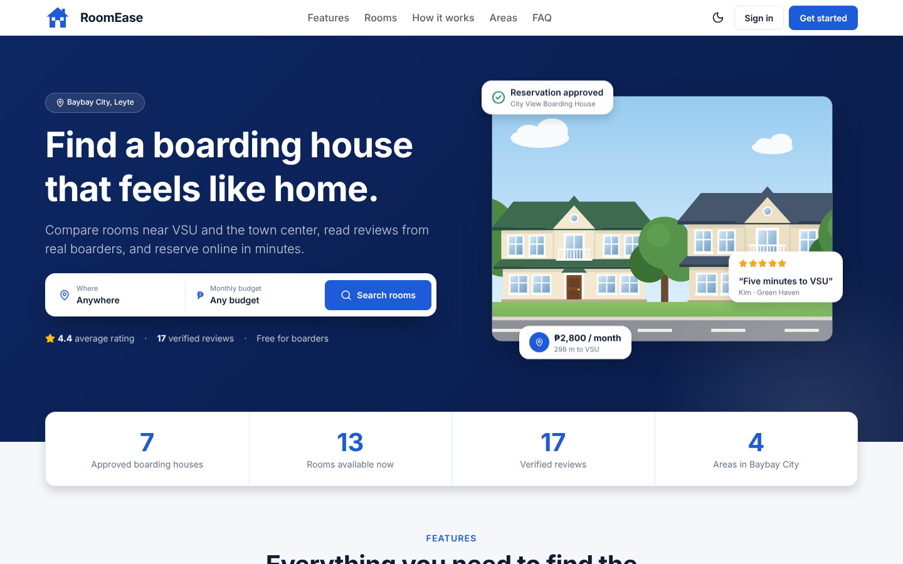
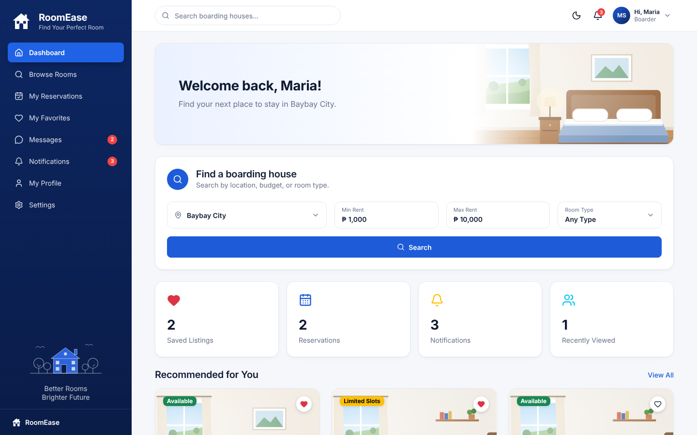
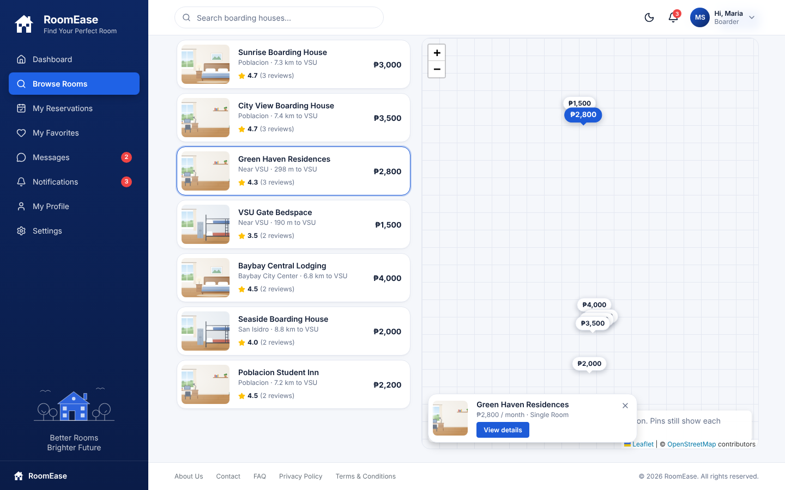
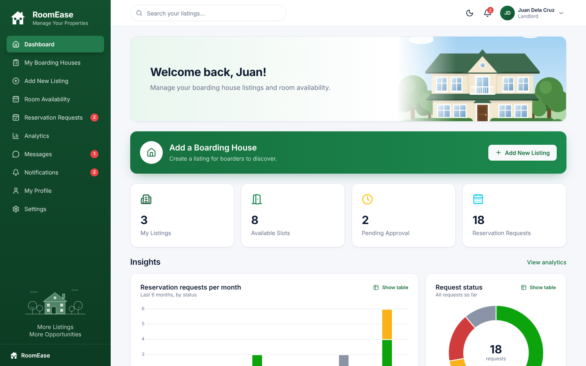
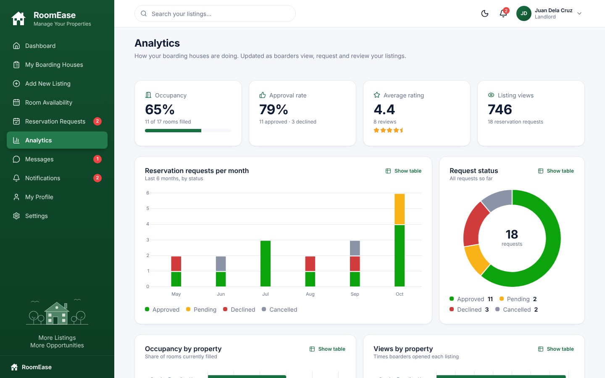
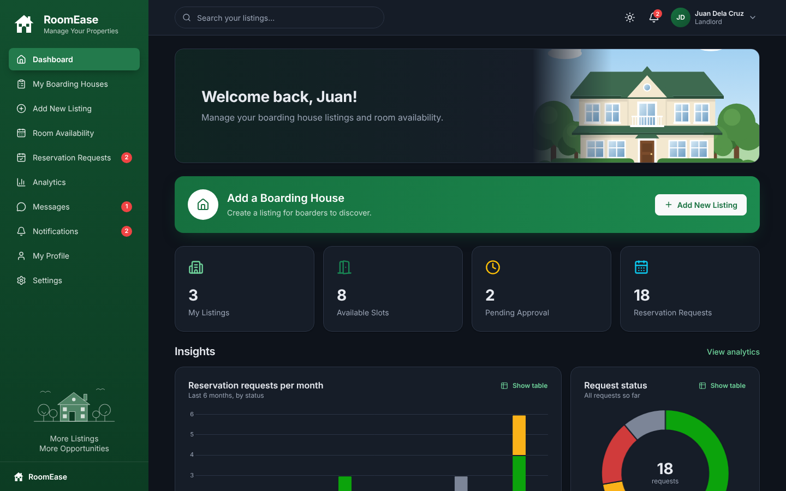

# RoomEase

Find and manage boarding houses in Baybay City. Frontend prototype built with **React + Bootstrap 5**: a public landing page, sign-in/sign-up, and full dashboards for **boarders** (browse, map, compare, reserve, review, chat) and **landlords** (listings, availability, requests, analytics, chat). Includes light and dark mode.

| Landing page | Boarder dashboard | Browse on the map |
| --- | --- | --- |
|  |  |  |
| **Landlord dashboard** | **Analytics** | **Dark mode** |
|  |  |  |

## Run it

```bash
npm install
npm run dev
```

Open http://localhost:5173. Sign in with a demo account (or click **Use** on the login page):

| Role | Email | Password |
| --- | --- | --- |
| Boarder | `maria@roomease.ph` | `boarder123` |
| Landlord | `juan@roomease.ph` | `landlord123` |

Other scripts: `npm run build` (production build to `dist/`), `npm run preview`, `npm run lint`.

## Features

**Everyone**
- Public landing page with search, featured top-rated rooms, how it works, FAQ
- Light / dark mode (top bar, account menu, or landing page), remembered per browser
- Short confirmation pop-ups (toasts), page fade-ins, and loading placeholders

**Boarders**
- Browse with filters (area, rent, room type, amenities, availability) and sorting, in a **grid or on a map** with price pins
- Room details with a **photo carousel** (swipe, arrow keys, full-screen), location map with distance to VSU and the town center, and **Get directions**
- **Ratings & reviews**: only boarders with an approved stay can review; edit or delete your own
- **Compare** up to 3 rooms side by side, with the best value in each row highlighted
- **Messages** with landlords, reservation requests, favorites, recently viewed, notifications

**Landlords**
- Dashboard with stats and **charts** (requests per month, request status); full **Analytics** page with occupancy, approval rate, average rating, views per property and a performance table (each chart has a table view)
- Add/edit listings with **up to 5 photos** and a **map pin**; room availability steppers
- Approve/decline reservation requests, **reply to reviews**, and **message boarders**

## Try these demos

- **Reservation flow:** as Maria, open a room and send a reservation request. Log out, sign in as Juan, approve it under **Reservation Requests**, then sign back in as Maria to see the notification.
- **Review:** as Maria, open **Green Haven Residences** (she has a past stay there) and rate it.
- **Live chat in two tabs:** in tab 1 sign in as Maria with **Remember me unchecked**; in tab 2 sign in as Juan the same way. Messages sent in one tab appear in the other right away.
- **Compare:** tap the scale icon on 2–3 room cards, then **Compare** in the tray at the bottom.

## Project structure

```
src/
  App.jsx                    routes (each page lazy-loaded) + role protection
  index.css                  Bootstrap theme overrides, per-role colors, dark mode, app styles
  config/navigation.js       sidebar items and role labels
  context/
    AuthContext.jsx          mock accounts: sign in, sign up, profile, password
    DataContext.jsx          stand-in backend: listings, reservations, reviews, messages, compare
    ThemeContext.jsx         light / dark mode
    ToastContext.jsx         confirmation pop-ups
  data/mockData.js           seed data (dates are relative to today), geo helpers
  data/storage.js            safe localStorage helpers
  components/
    auth/                    shared sign-in / sign-up layout
    charts/                  Chart.js charts and the numbers behind them
    illustrations/           SVG house, room and street scenes
    layout/                  sidebar, top bar, dashboard shell
    listings/                room card, listing row, filters, photo gallery, compare controls
    map/                     Leaflet map and the Browse map view
    reservations/            reservations table and review dialog
    reviews/                 stars, rating badge, reviews section
    ui/                      cards, badges, tabs, modal, form fields, skeletons, logo
  pages/
    Landing.jsx, Login.jsx, Signup.jsx, NotFound.jsx
    boarder/                 dashboard, browse, room details, compare, reservations, favorites
    landlord/                dashboard, listings, listing form/view, availability, requests, analytics
    shared/                  messages, notifications, profile, settings
```

## Notes

- **No backend yet.** Accounts and app data are saved in the browser's localStorage (passwords included, in plain text — demo only). Replace the functions in `AuthContext.jsx` and `DataContext.jsx` with API calls when the backend is ready.
- **Start over:** Settings → *Reset demo data* restores the original listings, reservations, reviews and messages.
- **Maps** use free OpenStreetMap tiles, so they need an internet connection. Pin locations are approximate. If tiles can't load, the pins still show.
- **Photos:** landlords can upload up to 5 photos per listing (resized in the browser). Browser storage holds roughly 5 MB, so many large listings can fill it; the app warns you if a save fails. Without photos, illustrations are shown.
- **Deploying:** this is a single-page app using browser routing, so the host must serve `index.html` for unknown paths (e.g. a rewrite rule on Vercel or Netlify).

See [PLAN.md](PLAN.md) for the build plan and next phases.
